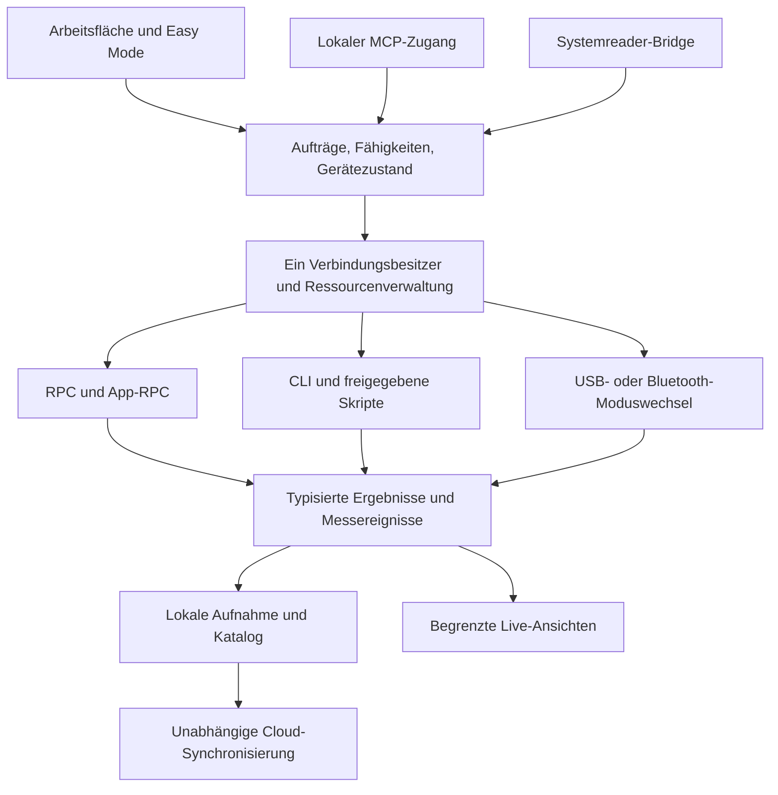

# Gemeinsamer Gerätebetrieb · Architekturvorschlag

Dieser Entwurf beschreibt Verantwortlichkeiten, keine bereits implementierten Klassen und keine Entscheidung für neue Bibliotheken. Ausgangsbelege: Q01–Q07, M-APP/M-GUI/M-STOR/M-GPIORPC/M-JS im [Quellenregister](10_sources.md).

## Eine Geräteverbindung, mehrere Bedienwege

UI, MCP und ein späterer Systemreader benutzen denselben Auftrags-/Zustandsweg. Kein Werkzeug öffnet nebenbei denselben seriellen Port. Die bestehenden qFlipper-Operationen werden nach Möglichkeit angebunden und um die fehlenden Wege ergänzt.

Der Systemreader kann weitere OS-Komponenten benötigen; der gemeinsame Weg ersetzt keinen Treiber-/Slotnachweis. Cloud-Arbeit nutzt den gespeicherten Stand und blockiert keinen Geräte-Stop. Geplante Release-Anbindungen: Google Drive, Dropbox, OneDrive, WebDAV und S3; Löschungen werden überall als Papierkorbzustand synchronisiert. Endgültige Löschung bleibt manuell.

## Fähigkeiten erst nach Verbindung bestimmen

Pro Verbindung: Geräteidentität, Firmwarefamilie/-revision, RPC-Version, verfügbare Kommandos, SD-Zustand und gegebenenfalls Helfer-Version erfassen. Fähigkeit getrennt halten als `verfügbar`, `Helfer fehlt`, `belegt`, `ungeprüft` oder `nicht unterstützt`, mit Grund und Quellen-/Teststand. Eine Versionsnummer allein beweist keine vollständige Feature-Abdeckung.

App-RPC-Nachrichten im Fork müssen gegen das aktuelle Firmware-Schema abgeglichen werden. Ein vorhandenes generiertes Struct bedeutet noch keinen Host-Wrapper und kein kompatibles Geräteverhalten. Bei inkompatiblem Schema keine unbekannten Kommandos ausprobieren oder einen Erfolg vortäuschen.

## Verbindungs- und Auftragszustände

Vorschlag für Verbindungszustände: getrennt → verbinden → erkennen → RPC/CLI betriebsbereit → ggf. Moduswechsel → Wiedererkennung; daneben belegt, Fehler und Wiederherstellung. RPC und CLI sind auf demselben Steuerkanal alternative Modi, keine gleichzeitig unabhängig geöffneten Verbindungen. Einzelne RPC-Broadcasts und Anfragen können koexistieren, wenn dies konkret geprüft wurde.

Vorschlag für Aufträge: vorbereitet → wartet auf Freigabe/Ressource → startet → aktiv → stoppt → abgeschlossen/abgebrochen/fehlgeschlagen. Verbindungsverlust kann zusätzlich einen unbekannten Gerätezustand hinterlassen. „Stop gesendet“ ist keine bestätigte Beendigung. USB-Profilwechsel werden vorab als erwarteter Verbindungsabbruch modelliert und nach erneuter Erkennung überprüft.

Jeder Auftrag enthält ID, Gerätegeneration, Ursprung (UI/MCP/Reader), Parameter, benötigte Ressourcen, eventuelle Aufnahme-ID und Abschlussgrund. Alte Antworten nach Wiederverbindung dürfen keine neue Sitzung verändern. Mutierende Geräteaktionen nicht blind automatisch wiederholen, wenn unbekannt ist, ob sie bereits ausgeführt wurden.

## Ressourcen und Konflikte

Konservative erste Belegung: Steuerkanal, Geräte-App/Loader, Funk-/NFC-/IR-/LF-Hardware, GPIO-Pins/Bus, OTG/Power, SD und USB-/BLE-Profil. Welche Kombinationen tatsächlich parallel gehen, entscheidet ein Test pro Kombination; kein globaler „Multitasking“-Schalter.

Wenn eine neue Aktion eine laufende Live-Messung verdrängen würde, wird der bestätigte Nutzerablauf ausgelöst: „Messung beenden und Aktion starten“ oder „Abbrechen“. Bis zur Antwort bleibt die Messung aktiv. Nach Zustimmung zuerst beenden und Aufnahme abschließen, erst nach bestätigter Freigabe wechseln. Das gilt auch für einen MCP-Auftrag. Der MCP-Auftrag kann warten oder eine klare Konfliktantwort liefern; Timeout gilt nie als Zustimmung.

Aufwendige Dateiübertragung/Backup kann eine ruhende Geräte-App benötigen. Falls dadurch eine Live-Sitzung enden müsste, gilt derselbe Konfliktablauf. Cloud-Upload und reine Desktop-Auswertung können grundsätzlich unabhängig laufen; Datenträger-/Speicherlast trotzdem begrenzen.

## Helfer auf SD

Zwei Kandidaten bei unverändertem Momentum:

- JS-Skript mit vorhandenen Modulen und Ausgabe über `js <path>`: geringer Geräteaufwand, zunächst für GPIO/UART/I²C/SPI oder RSSI prüfen.
- FAP mit App-RPC-DataExchange: Kandidat für definierte Nachrichten und dauerhafte Sitzungen, besonders NFC. Exporte, ABI, Paketversion, Rückkanal und Größen-/Flussgrenzen erst nachweisen.

Vor Installation Quelle, Zweck, Version/Hash, Zielpfad, benötigte Hardware und Änderungen zeigen; ausdrückliche Freigabe verlangen. Bei Ablehnung bleibt die passende Funktion klar als nicht eingerichtet erkennbar. MCP-Gesamtfreigabe ersetzt diese ausdrücklich vereinbarte Helferfreigabe nicht stillschweigend. Bestätigt: jede neue Helferversion erneut ausdrücklich freigeben. Vertrauen in die Quelle erlaubt kein automatisches Update. Vorschlag für den Austausch: vorhandene Datei vor Überschreiben sichern; technische Ausführung und Kompatibilität noch nachweisen.

Helfer brauchen Protokollversion, Start-/Stop-Antworten, Fehlermeldungen, Sequenzen und getestetes Aufräumen. Ein Skript, das nur beliebigen Text ausgibt, ist noch kein stabiler Messdatenvertrag. Keine Installation in dieser Planungsrunde.

## Live-Daten und dauerhafte Aufzeichnung

Bestätigt: jede gestartete Live-Sitzung dauerhaft speichern. Vorschlag für die Umsetzung:

1. Vor Gerätestart lokal ein Sitzungsmanifest anlegen und beschreibbare Ablage prüfen. Vorschlag bei nicht möglicher Aufnahme: Start anhalten und Speicherproblem erklären; kein unbemerkter ungespeicherter Modus. Gemeinsame Abnahme erforderlich.
2. Originaldaten/Ereignisse fortlaufend in begrenzten Blöcken schreiben, Manifest mit Geräte-/Firmware-/Helferstand, Parametern, Datenprofil und Startzeit führen. Keine unbeschränkte Liste im RAM; Format und Index noch entwerfen.
3. Für die Anzeige begrenzen oder ausdünnen, die gespeicherten Originaldaten dadurch nicht verändern. Geräteverlust, Parserfehler, Overrun, Queue-Überlauf und Datenträgerfehler als Ereignis sichtbar erhalten. Lücken dürfen nicht durch verbundene Kurven verschwinden.
4. Geräteticks, relative Pulslängen und Empfangszeit des Computers getrennt speichern. Keine Uhrgleichheit oder Startzeit eines Frames behaupten, wenn nur die Ankunft am Host bekannt ist.
5. Stop/Fehler/Abziehen abschließen; nach App-Absturz lesbare Teilaufnahme mit Unterbrechungsmarke wiederfinden. Bei Speicherfehler Stop anfordern; ob er am Gerät wirkte, separat ausweisen.
6. Fertige Blöcke für konfigurierte Cloud-Synchronisierung freigeben. Ob und wie unvollständige Sitzungen auf dem zweiten Computer live sichtbar sein sollen, ist noch zu entscheiden; keine Remote-Live-Steuerung aus Cloud-Sync ableiten.

Exakte Schreibraten, Größenobergrenzen und Anzeigeintervalle ergeben sich aus Machbarkeitstests. Automatische Bereinigung ist anfänglich aus; ein voller Datenträger kann daher den nächsten Start blockieren. Die App muss Größe und verbleibenden Platz früh sichtbar machen.

## MCP

Ein gemeinsames Modell für Geräteinformationen, Fähigkeiten, Dateien/Bibliothek, Aufträge, Live-Sitzungen, Aufnahmen, Backup und Firmware-Verwaltung. Werkzeuge liefern Auftrags-/Sitzungs-IDs und nachvollziehbare Zustände; große Daten nicht als unbegrenzte einzelne Textantwort zurückgeben. Konkrete Toolnamen, Transport und MCP-Version gehören in die spätere Schnittstellenspezifikation.

Nach bewusster Gesamtfreigabe auf diesem Computer darf MCP den vereinbarten vollen Funktionsumfang bedienen. Keine zusätzlichen Einzelbestätigungen für jeden normalen Befehl erfinden. Bestehende Produktregeln gelten weiter: Ressourcenkonflikt mit aktiver Messung, ausdrückliche Freigabe vor Installation jeder Helferversion und kein Update/Wechsel/Restore ohne geprüftes Backup. Weitere technische Update-/Restore-Details bleiben offen. Aktivierung, aktive Clients und Entzug der Freigabe in den Einstellungen sichtbar; Netzfreigabe nicht aus lokalem MCP ableiten.

Freigabe bleibt lokal gebunden und darf durch Cloud-Sync weder auf einem anderen Computer aktiviert noch nach Rücksetzen automatisch wiederhergestellt werden. Zugangsdaten/Endpoint-Authentisierung noch entwerfen. Systemreader-Verwendung besitzt Hardware über dieselbe Ressourcenverwaltung, statt bestehende Messungen unbemerkt zu beenden.

## NFC als Systemreader: eigener Machbarkeitsvertrag

M-APDU belegt vorab übergebene APDU-Listen; M-CCIDCMD enthält Beispielantworten. Beides ist kein Beweis für einen produktiven NFC-Systemreader. Zu erproben:

- Helfer hält dieselbe Karte aktiv, weitere Kommandos können von vorherigen Antworten abhängen; Reset, Entfernen, Wiederauflegen, Timeout und Stop sind klar erkennbar.
- Mac meldet einen echten Reader-Slot an eine unabhängige PC/SC-/Smartcard-Anwendung. Ein uFlipper-interner APDU-Dialog oder ein nur speziell angepasster Client genügt nicht.
- Kartentechnik, ATR-/Protokollabbildung, Kartenstatus, Transaktionssperren, Disconnect und wiederholte Nutzung werden geprüft. Nicht jede NFC-Karte verhält sich wie eine ISO-7816-Smartcard.
- Kandidaten: Host-Bridge mit virtueller Reader-Anbindung oder FAP mit CCID/NFC-Profil. Aktuelle macOS-Kompatibilität, nötige OS-Installation/Signierung und Koexistenz mit Steuerkanal erst feststellen. Kein Kandidat wurde ausgewählt oder installiert.
- Linux-Systemreader zusätzlich fachlich abgrenzen. Ein Erfolg auf Linux wäre kein Nachweis für Mac.

Ein negatives Ergebnis muss als Gate-Befund zurück in die Planung. Keine heimliche Firmwareänderung, kein Weglassen des geforderten Systemreaders und keine Umbenennung eines Spezialclients zum Systemreader.
